#  Módulo de Banco de Dados - Orion Bootcamp

Este repositório contém as soluções práticas dos exercícios de Banco de Dados Relacional (PostgreSQL) e Não-Relacional (MongoDB) desenvolvidos durante o bootcamp.

---

##  Exercício 1 - Banco Relacional (SQL Básico)

### Critérios de Aceite & Evidências

1. **O comando `CREATE TABLE` executa sem erros:**
   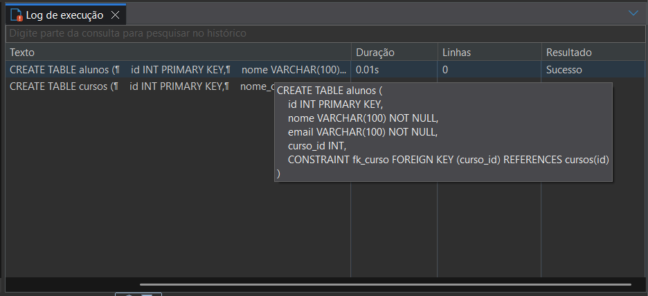

2. **A chave estrangeira impede a inserção de aluno com `curso_id` inexistente:**
   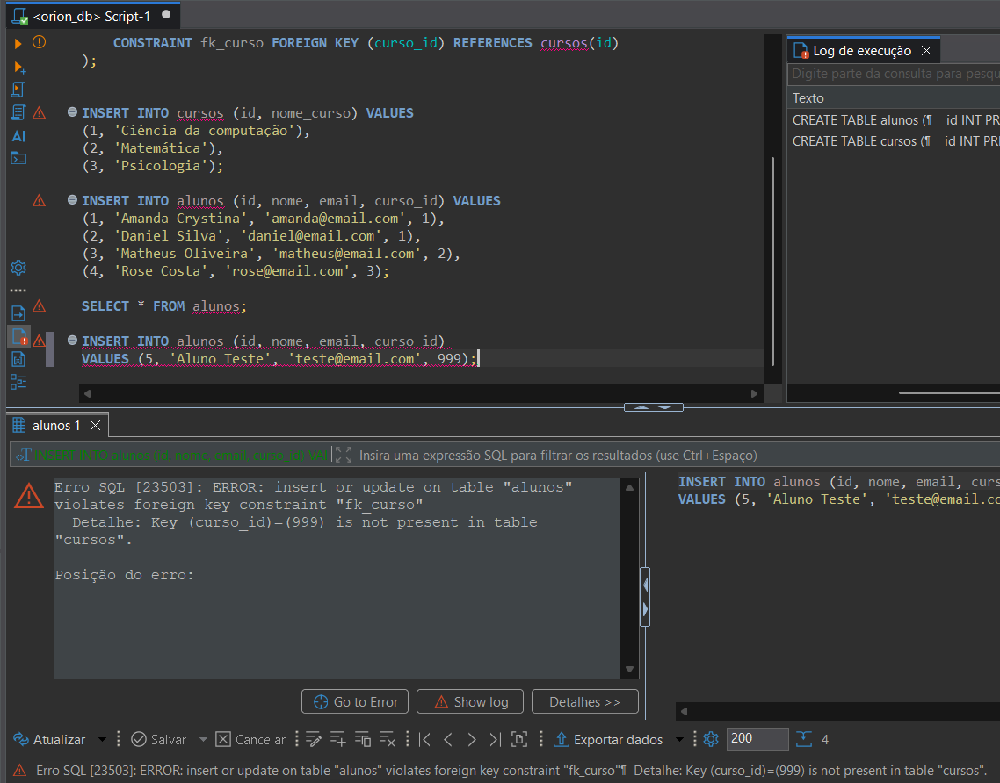

3. **O comando `SELECT * FROM alunos;` retorna todos os alunos inseridos:**
   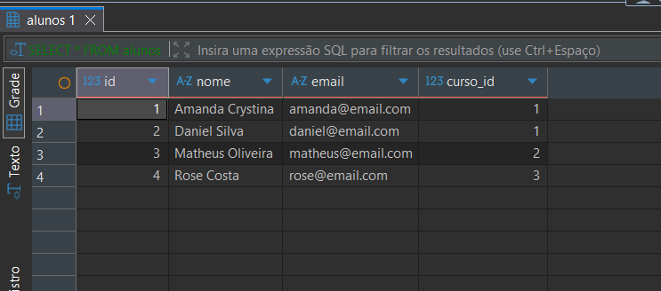

---
##  Exercício 2 - Banco Relacional (JOINs e Filtros)

### Critérios de Aceite & Evidências

1. **Consulta `INNER JOIN` (Nome do Aluno e Curso):**[cite: 4, 11]
   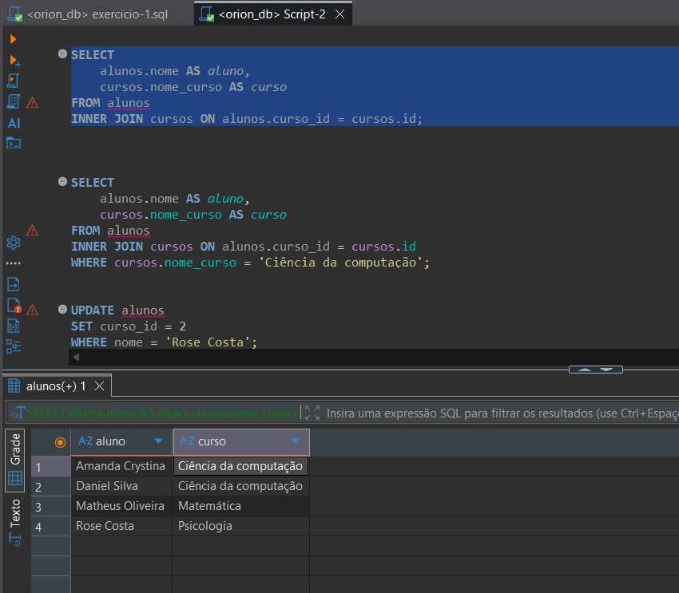

2. **Consulta com `WHERE` e `JOIN` (Filtro por Curso):**[cite: 4, 11]
   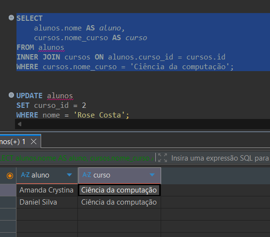

3. **Execução de `UPDATE` e verificação da alteração:**[cite: 4, 11]
   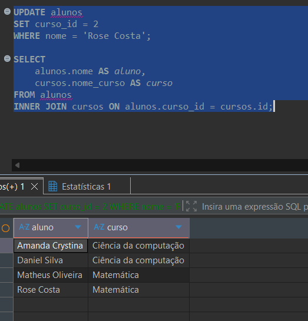

*(Opcional - Extra):*
* **Consulta `LEFT JOIN` para identificar cursos sem alunos:**[cite: 4, 11]
   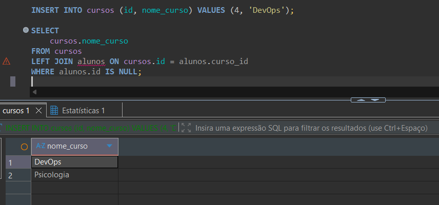

---

##  Exercício 3 - Não Relacional (CRUD Básico)

###  Critérios de Aceite & Evidências

1. **Criação da coleção `posts` e inserção de documentos:**[cite: 5, 12]
   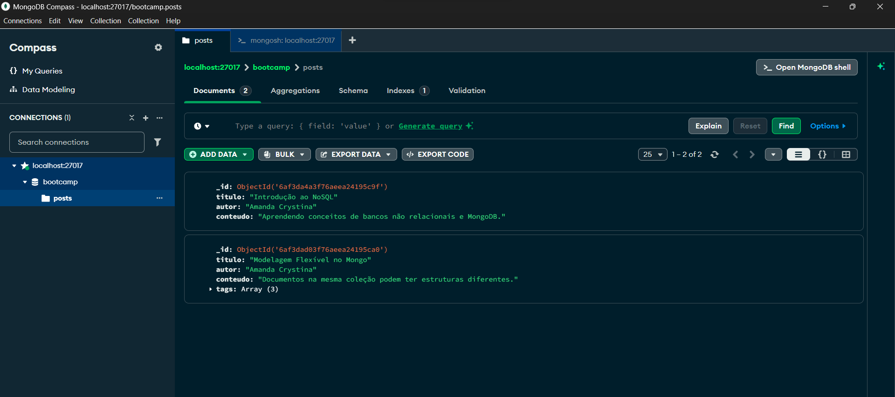

2. **Demonstração do Schema Flexível (Post com campo `tags`):**[cite: 5, 12]
   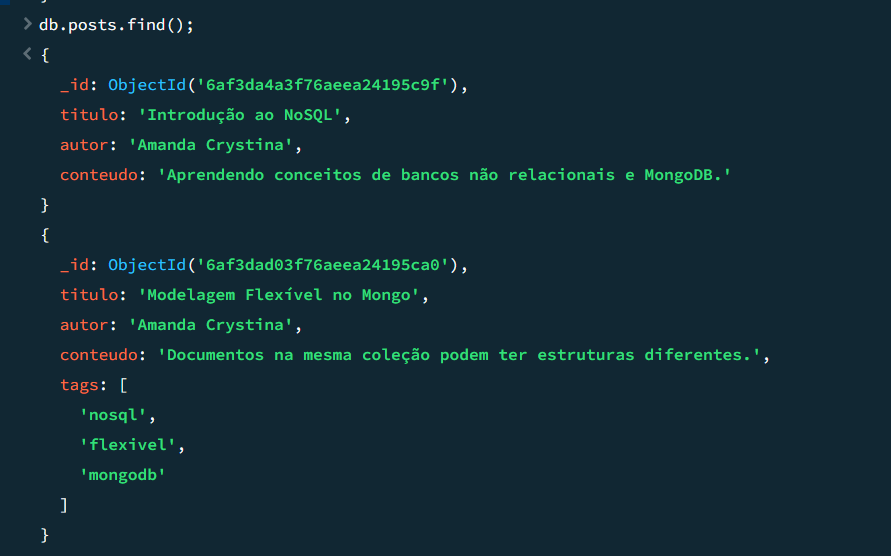

---

## Exercício 4 - NoSQL (Consultas Avançadas & Docker Compose)

### 1. Teste no Ambiente de Desenvolvimento (`docker-compose.dev.yml`)
Subida do container `mongo_dev_ex4`, execução do `updateOne()` para inserção de comentários aninhados e consultas `find()` avançadas por tag e autor.

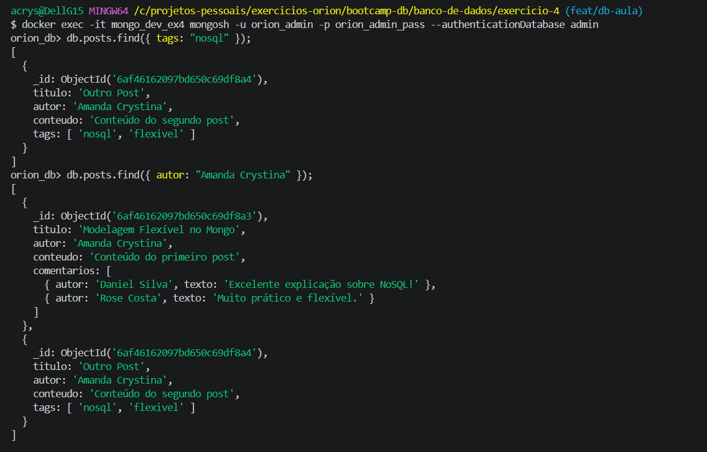

---

### 2. Teste no Ambiente de Produção (`docker-compose.prod.yml`)
Validação dos mesmos filtros avançados e estrutura de dados rodando de forma independente no container `mongo_prod_ex4`.

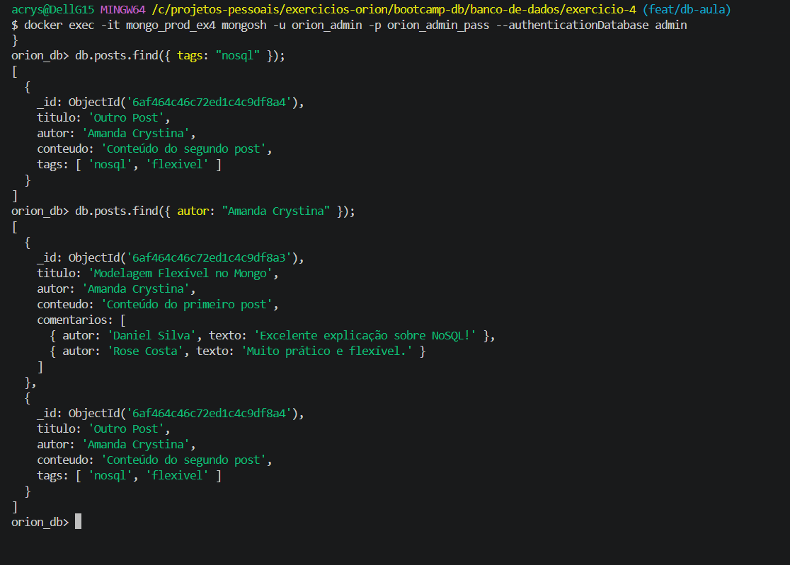